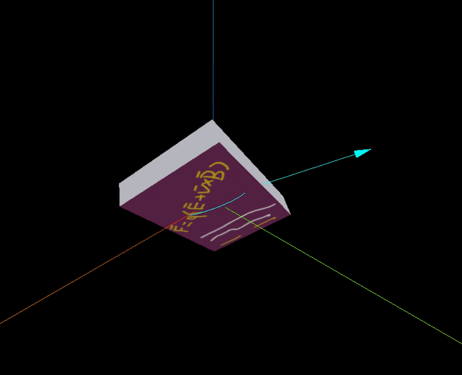

# The Dzhanibekov Effect visualized in ThreeJS

The Dzhanibekov effect is a counter intuitive result that falls out of the equations of rotational motion in 3 dimensions. A rotating, rigid body with no torque applied can appear to flip periodically.

## 🎥 Demo

<p align="center">
  
</p>

## To-do

-Implement Quaternions
-Compare numerical methods to explicit solutions involving Jacobi elliptic integrals

## Get Started

```bash
git clone https://github.com/bryanhoffman/dzhanibekov-ode-benchmarks.git
cd dzhanibekov-ode-benchmarks
npm install
npm start
```

Visit http://127.0.0.1:3000

## Three.js Boilerplate

This project was made possible using Sean Bradley's Threejs Boilerplate and opensource contributors to Threejs and countless other projects. Thanks to the many people who've helped make such pet projects possible today.

https://github.com/Sean-Bradley/Threejs-Boilerplate
